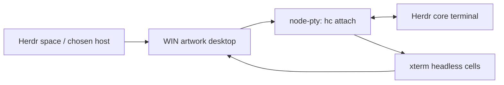

# Architecture

WIN is a viewer. Herdr core owns the terminal processes; the artwork owns their
on-screen frames. Separating these lifetimes lets a window close without killing
the shell or coding agent behind it.

## Modules

| File | Responsibility |
| --- | --- |
| `bin/win.mjs` | Parse options, select theme/host, load the verified artwork adapter |
| `src/adapter.mjs` | Apply uniquely anchored hooks to a generated artwork copy |
| `src/plugin.mjs` | Native window views, chooser/forms, input routing, lifecycle |
| `src/herdr.mjs` | JSON CLI requests, address validation, directory validation |
| `src/session.mjs` | PTY attachment, VT emulation, backpressure, cell conversion |
| `src/input.mjs` | Streaming escape, mouse, and bracketed-paste parsing |
| `src/agents.mjs` | Resume agents with stable core names and separate argv arguments |
| `bin/win_launch.py` | Shared Claude/Codex Herdr tab and space request builder |
| `setup/` | Opt-in host launchers, core settings, remote install, and menu patching |

## Input and rendering

Only WIN's Ctrl-G prefix and artwork/menu interactions are intercepted. Ordinary
shell input is forwarded unchanged. Bracketed paste is parsed separately so pasted
control bytes cannot accidentally trigger WIN shortcuts. Terminal mouse coordinates
are translated into the selected window's interior.

Each session runs an `hc attach` client inside a node-pty PTY. xterm headless
interprets its output; the artwork renderer copies visible cells and palette
attributes into the window. High/low watermarks pause output reads while the VT
parser catches up. Resize follows the visible window's interior dimensions.

The artwork's packed 8-bit foreground/background attributes are widened in the
generated copy. Higher bits identify our palette bank; lower bits retain the
original foreground/background indexes. This keeps frames and terminal cells in
the host's selected theme. Upstream minified names are confined to the adapter
where possible; native view methods used by the plugin remain version-dependent.

## Session lifetime and host boundaries

`hc run --bg --no-parent --no-notify` creates an independent core terminal.
Closing a viewer kills only its attach process. WIN never issues `hc kill`,
`hc rm`, or `hc server stop`. Explicit shell argv avoids recursively launching WIN
when the core is configured to use WIN as its default shell.

WIN rejects machine-qualified terminal addresses and filters them from discovery.
Herdr chooses the host before launching WIN. Directory existence and permissions
are checked on that host, not on the Mac displaying its remote session.

Agent names use an agent-specific prefix plus 28 hex digest characters, staying
within hc's 32-character limit. The full UUID remains in the agent's argv; it is
never truncated. Reuse by name prevents duplicate sequential requests, but is not
a cross-process transaction for simultaneous launch requests.

## Artwork compatibility

Supported upstream client SHA-256:

`ce1bed685670b04fbc52421567aff17f7b54e559ab44ebc8ea9129bc80d057f2`

`tty.mjs` is downloaded separately, kept unmodified, and ignored by Git. At launch,
the adapter verifies this hash and applies each replacement only when its anchor
is unique. The generated client lives in `.win-cache/` and retains upstream notices.
Unknown builds fail closed. Do not simply replace the hash after an upstream update:
review changed internals, revise hooks, and run full PTY/visual checks first.

The upstream artwork and locally cloned Herdr UI are not covered by this project's
license. The public repo contains integration code and small compatibility anchors,
not complete copies of those programs.
